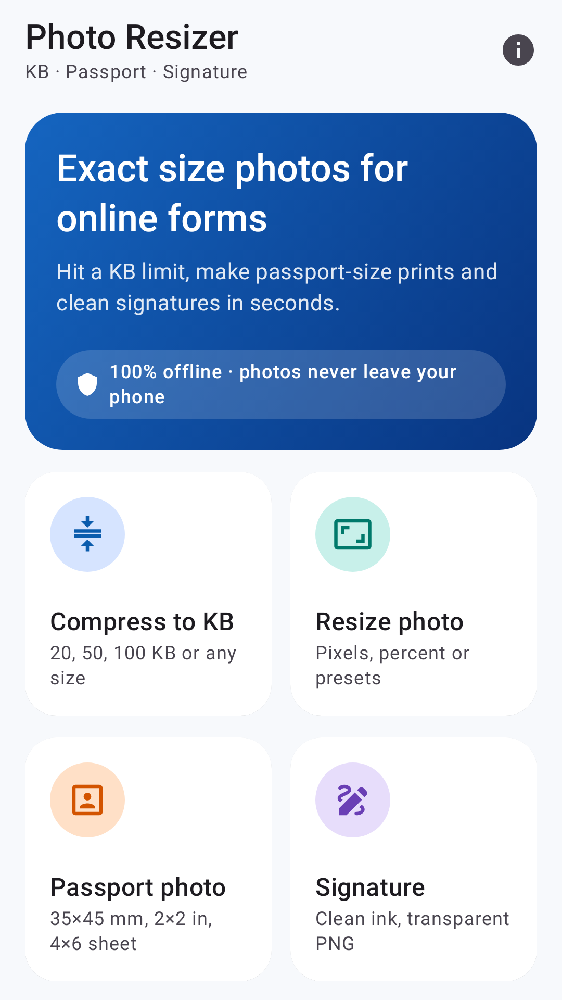
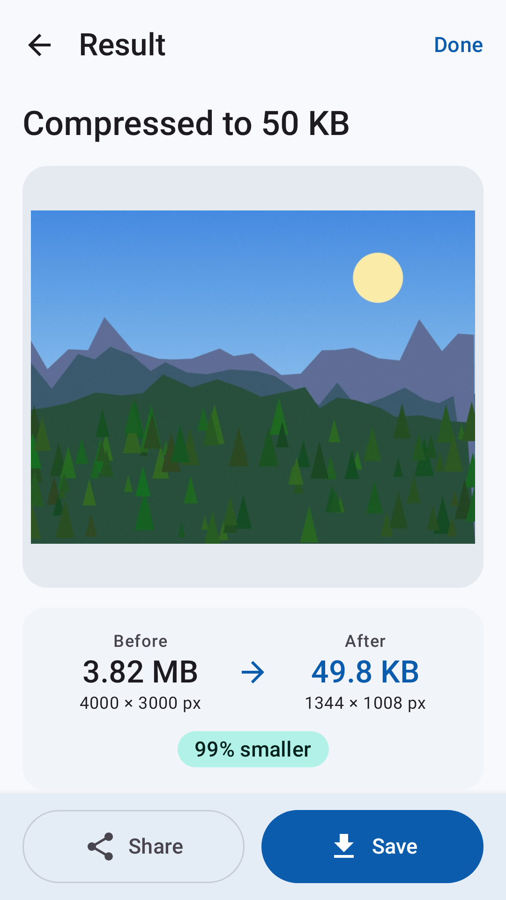
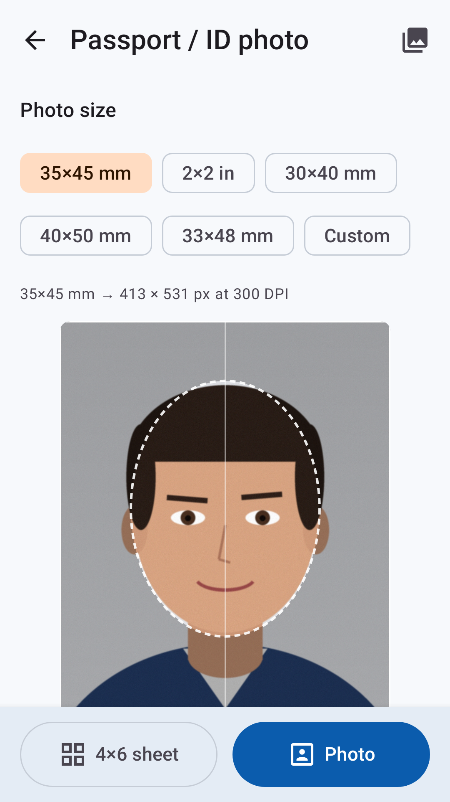
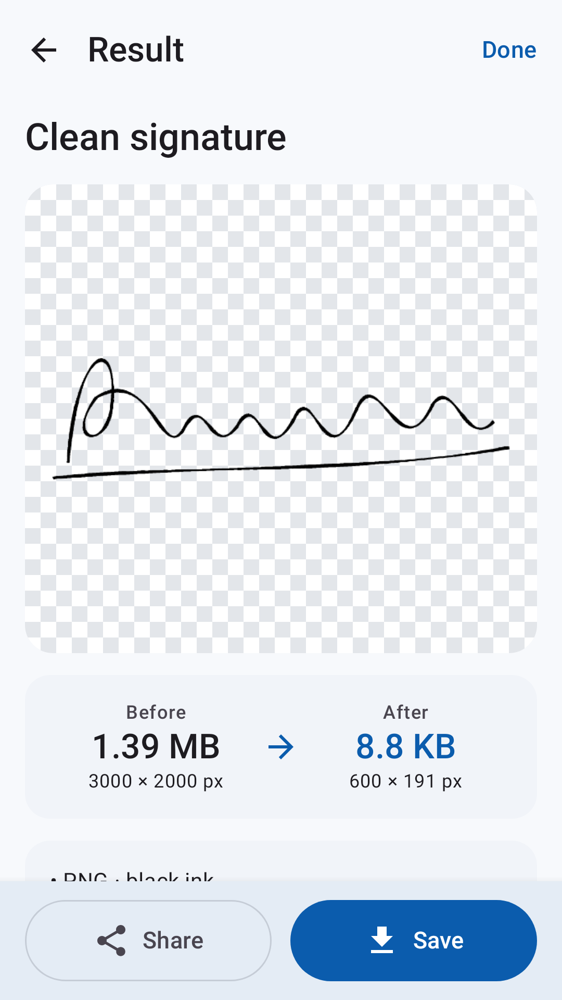

# Photo Resizer: KB & Passport

[](https://github.com/OfferPk/photo-resizer/actions/workflows/android.yml)

A polished, **fully offline** Android toolkit for online-form photos:

- **Compress to exact KB** – 20 / 50 / 100 / 200 / 500 KB presets or any custom size. Binary-searches JPEG quality and scales down only when needed; shows before/after size and dimensions.
- **Resize** – by pixels (aspect lock), percentage, or presets (fit inside / crop to fill), JPEG or PNG.
- **Passport / ID photo** – 35×45 mm, 2×2 in, 30×40, 40×50, 33×48 mm or custom mm at **300 DPI** (DPI written into the JPEG), pinch/drag crop with face guide, optional *white background* for plain light walls, optional max KB.
- **4×6 in print sheet** – as many copies as fit (e.g. 8 × 35×45 mm, 6 × 2×2 in) with cut guides at 300 DPI.
- **Signature cleaner** – crop, auto/manual threshold with lighting normalisation (removes shadows), black or blue ink, white or **transparent PNG**, auto-trim, output width.
- **Save & share** – MediaStore to `Pictures/PhotoResizer` (no permission on Android 10+, legacy `WRITE_EXTERNAL_STORAGE` only up to API 28) and the system share sheet.

Photos are picked **only** with the system Photo Picker (`PickVisualMedia`) – the app declares no `READ_MEDIA_IMAGES` / `READ_EXTERNAL_STORAGE`, and nothing is uploaded. Network is used only by ads.

| | | | |
|---|---|---|---|
|  |  |  |  |

Privacy policy: https://offerpk.github.io/photo-resizer/privacy.html · Site: https://offerpk.github.io/photo-resizer/

## Tech
Kotlin · Jetpack Compose · Material 3 · Navigation-Compose · Coroutines · Google Mobile Ads SDK · Google UMP (consent).
`compileSdk 36`, `targetSdk 36`, `minSdk 24`, package `com.offerpk.photoresizer`, AGP 9.4, Gradle 9.8, JDK 21 in CI.

```
app/src/main/java/com/offerpk/photoresizer/
  core/KbCompressor.kt    pure-Kotlin exact-KB search (unit-tested on the JVM)
  core/AdGate.kt          interstitial rules (unit-tested)
  core/Units.kt           mm↔px, KB formatting, 4×6 sheet layout
  image/                  decoding (EXIF, sampling), image ops, MediaStore save / share
  ads/                    AdConfig, AdsManager (UMP → MobileAds → interstitial), BannerAd
  ui/                     Compose screens + croppers
```

## Ads (Google test IDs by default)
All ad IDs live in **one file: [`admob.properties`](admob.properties)**. The app ID is injected into the manifest meta-data `com.google.android.gms.ads.APPLICATION_ID` via a manifest placeholder, the unit IDs become `BuildConfig` fields read by `ads/AdConfig.kt`.

| | Test ID (current) |
|---|---|
| App ID | `ca-app-pub-3940256099942544~3347511713` |
| Banner | `ca-app-pub-3940256099942544/6300978111` |
| Interstitial | `ca-app-pub-3940256099942544/1033173712` |
| Rewarded (reserved, unused in 1.0) | `ca-app-pub-3940256099942544/5224354917` |

**To go live:** replace the four values in `admob.properties` with your AdMob IDs, bump `versionCode`, tag a release. Nothing else changes.

Placement rules (see `core/AdGate.kt`, `ads/AdsManager.kt`):
- UMP consent info is requested (and the form shown if required) **before** `MobileAds.initialize()` and before any ad request; ads load only when `canRequestAds()` is true. *About & privacy → Privacy options* re-opens the form where required.
- Adaptive **banner** only on the Home screen, at the bottom.
- **Interstitial** only after a successful export (save or share), shown at the natural break when leaving the Result screen, **never on the first export of a session**, and **at most once per 90 s**.
- No app-open ads, no ads inside editors, no rewarded ads in 1.0.

## Build
```bash
# Android SDK with platforms;android-36 and build-tools;36.0.0, JDK 17+ (CI uses 21)
./gradlew testDebugUnitTest          # unit tests
./gradlew assembleDebug              # debug APK

# Signed release (env vars, or a git-ignored keystore.properties with storeFile/storePassword/keyAlias/keyPassword)
export ANDROID_KEYSTORE_FILE=/path/upload.jks KEYSTORE_PASSWORD=... KEY_ALIAS=... KEY_PASSWORD=...
./gradlew bundleRelease assembleRelease
```

### CI / releases
`.github/workflows/android.yml` runs on every push to `main`, on PRs and manually: unit tests → signed release **AAB + APK** (JDK 21) → verification (`apksigner`, `jarsigner`, `aapt2` targetSdk 36 and a check that no media-read permission is merged) → artifacts. Pushing a `v*` tag also creates a GitHub Release with both files and `SHA256SUMS.txt`.
Required repo secrets: `KEYSTORE_BASE64`, `KEYSTORE_PASSWORD`, `KEY_ALIAS`, `KEY_PASSWORD`.
`.github/workflows/pages.yml` publishes `docs/` (landing page + privacy policy) to GitHub Pages.

## Tests
- `KbCompressorTest` – real JPEG encoding (javax.imageio) on photo-like images: 20/50/100/200 KB targets land **at or under the target and within 5 %** of it; keep-dimensions mode, tiny targets and impossible targets.
- `AdGateTest` – no ad without export, none on the first export, 90-second cap.
- `UnitsTest` – 300-DPI mm→px (35×45 mm = 413×531 px, 2 in = 600 px), KB formatting, 4×6 sheet layouts.
- `StoreScreenshots` (opt-in) – renders the real screens with Robolectric + Roborazzi for the store:
  `./gradlew :app:testDebugUnitTest --tests '*StoreScreenshots*' -Pscreenshots -Proborazzi.test.record=true`, then `python3 tools/make_store_graphics.py`.

## Store kit
`store/` – `icon-512.png`, `feature-graphic-1024x500.png`, `screenshots/` (1080×1920, captioned + raw), `listing-en.md`, `play-console-answers.md`, `LAUNCH-CHECKLIST.md`. Icons are generated by `tools/make_icons.py`.

## License
MIT – see [LICENSE](LICENSE). Photo sizes are common presets; the app is not affiliated with any government agency.
